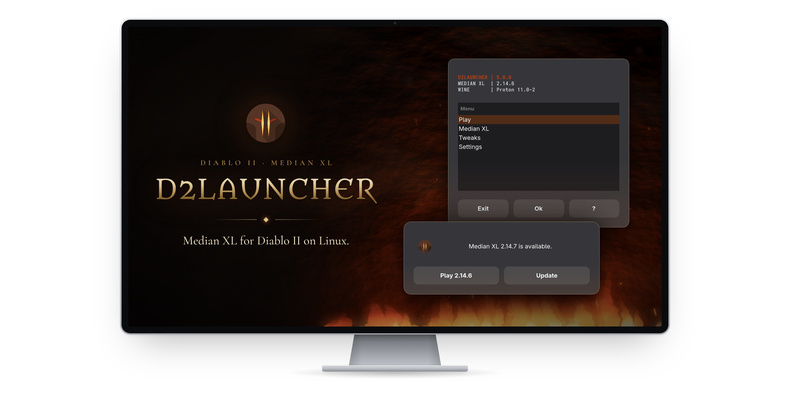

<div align="center">



<p><b>Median XL</b> for Diablo II on Linux.</p>

**[➜ Reference](REFERENCE.md)** · **[➜ Contributing](CONTRIBUTING.md)**

<p>
  <a href="https://aur.archlinux.org/packages/d2launcher"></a>
  <a href="https://github.com/murkl/d2launcher/releases/latest"></a>
  <a href="../LICENSE"></a>
</p>

</div>

> [!IMPORTANT]
> D2Launcher needs an original Diablo II with Lord of Destruction, installed in full from the discs or the Blizzard download. Any version works, Median XL brings its own files. Diablo II: Resurrected does not work.

## Features

- Set up by choosing one folder
- Median XL updates file by file, each checked
- Your own files stay through updates
- Every Median XL version at hand
- Diablo II alone with one setting
- Launch options as in Steam
- Sharp graphics from the first start
- D2Stats with one setting
- Tweaks for D2GL and cnc-ddraw
- Backups of the game and the saves
- Wine included, no 32-bit libraries
- Runs on any distribution

## Installation

### Arch Linux

From the **[AUR](https://aur.archlinux.org/packages/d2launcher)**, with paru or yay:

```sh
paru -S d2launcher
```

### Other Distributions

Install what D2Launcher needs. Wine comes with it.

| Distribution | Command |
| --- | --- |
| Debian, Ubuntu | `sudo apt install zenity curl jq zip unzip` |
| Fedora | `sudo dnf install zenity curl jq zip unzip` |
| openSUSE | `sudo zypper install zenity curl jq zip unzip` |

Unpack the newest **[➜ release](https://github.com/murkl/d2launcher/releases/latest)** and start `d2launcher` in it. It adds itself to the app menu and updates itself under **Settings › Update D2Launcher**.

## First Start

Start **Diablo II** from the app menu and choose your Diablo II folder. D2Launcher copies it and sets up Wine and Median XL. Then **Play** starts the game.

<br>

<p align="center"><sub>Diablo is a trademark of Blizzard Entertainment, Median XL the work of its team. D2Launcher belongs to neither.</sub></p>
